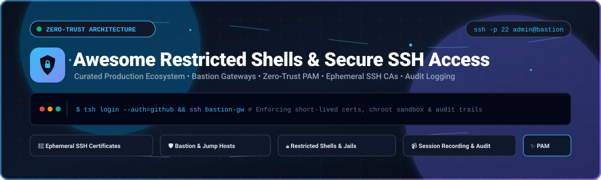

  

# 🛡️ Awesome Restricted Shells & Secure SSH Access 🔐

  
  
  
  
  
  

> 🚀 **A curated, production-tested directory of enterprise SaaS solutions and open-source GitHub projects for Restricted Shells, SSH Bastions, Zero-Trust Privileged Access Management (PAM), Ephemeral Certificate Authorities, and Terminal Session Auditing.**

---

## 📑 Table of Contents
- [🔍 Sector Overview & Market Dynamics](#-sector-overview--market-dynamics)
- [☁️ SaaS & Hosted Platforms](#️-saas--hosted-platforms)
- [💻 Open-Source GitHub Projects](#-open-source-github-projects)
- [🧱 Architectural Blueprints & Hardening](#-architectural-blueprints--hardening)
- [🤝 How to Contribute](#-how-to-contribute)
- [💖 Support](#-support)
- [⭐ Star History](#-star-history)
- [⚠️ Security Disclaimer](#️-security-disclaimer)

---

## 🔍 Sector Overview & Market Dynamics

The global **Privileged Access Management (PAM) and Zero-Trust Infrastructure Access** sector is estimated at **$4.5B to $5.5B in 2026** and is expanding at a robust **15%–21% CAGR**, driven by cloud-native migration, strict compliance mandates (SOC2, ISO 27001, FedRAMP), and the urgent need to eliminate static SSH credentials and manage non-human/workload identities.

The market exhibits a **moderately concentrated, bifurcated structure**:
- **Consolidated Enterprise Tier:** Established cybersecurity conglomerates (led by CyberArk, BeyondTrust, Delinea, and hyperscaler clouds) control roughly 50%–55% of global revenue through full-stack compliance suites.
- **Fragmented, High-Velocity Innovation Tier:** The remaining 45%–50% of the market is heavily fragmented, fueled by agile, venture-backed innovators (Teleport, StrongDM, Cloudflare One) and thriving open-source ecosystems pioneering Just-in-Time (JIT) access, eBPF-driven audit pipelines, and ephemeral SSH certificate authorities.

---

## ☁️ SaaS & Hosted Platforms

The following table benchmarks category-leading hosted Privileged Access Management (PAM), SSH bastion gateways, and zero-trust remote access platforms. Entries are sorted descending by **Company Scale / Valuation / Market Cap**.

| 🏢 Platform | 💰 Company Valuation / Market Cap | 🏷️ Starting Pricing Tier | 🎁 Free Tier Limit / Evaluation | 🎯 Core Focus & Capabilities |
| :--- | :--- | :--- | :--- | :--- |
| **[Microsoft Azure Bastion](https://azure.microsoft.com/en-us/products/azure-bastion/)** | **~$3.66 Trillion** *(Public: MSFT)* | **$0.19 / hour** (Basic tier, ~$140/mo per deployment; Standard at $0.29/hr) | **Free Developer SKU** (1 concurrent VM connection, shared infrastructure, no public IP/VNet peering required) | Fully managed PaaS delivering secure TLS-tunneled SSH & RDP browser/CLI access to Azure VMs without public IPs. |
| **[AWS Systems Manager Session Manager](https://aws.amazon.com/systems-manager/)** | **~$2.66 Trillion** *(Public: AMZN)* | **$0.00** on Amazon EC2 instances (Free at no extra charge; on-prem/hybrid nodes use Advanced Tier at $0.00695/instance-hr) | **Free Forever** for EC2 instances (Unlimited sessions & connections; pay only for optional CloudWatch/S3 audit logs) | Agent-based, IAM-authenticated interactive shell and port forwarding without inbound firewall rules or public bastion hosts. |
| **[Cloudflare Access (Zero Trust SSH)](https://www.cloudflare.com/products/zero-trust/access/)** | **~$98.0 Billion** *(Public: NET)* | **$7.00 / user / month** (Pay-As-You-Go plan with 30-day log retention and unlimited users) | **Free Forever up to 50 users** (Includes Zero Trust Network Access, Gateway DNS filtering, WARP client, 24-hr log retention) | Identity-aware reverse proxy and browser web terminal verifying SSO/MFA before traffic reaches internal servers. |
| **[Okta Privileged Access](https://www.okta.com/products/privileged-access/)** | **~$30.5 Billion** *(Public: OKTA)* | **$17.00 / user / month** (Workforce Identity Essentials suite, includes up to 2 privileged admins; min $1,500/yr spend) | **30-Day Free Trial** (Full evaluation of Workforce Identity platform & PAM administration modules) | Cloud-native privileged access governance, ephemeral SSH/RDP certificates, and automated PAM workflows tied to Okta identity. |
| **[CyberArk Remote Access (Alero)](https://www.cyberark.com/products/vendor-privileged-access-manager/)** | **~$20.6 Billion** *(Public: CYBR)* | **~$43.33 / user / month** (~$520/user/year list price for external vendor PAM seats; sold in enterprise packs) | **Guided 30-Day Evaluation Tenant** (Time-bound Proof of Concept arranged through CyberArk enterprise sales) | Zero-trust biometric mobile authentication (FIDO2) and session isolation for remote third-party vendors without VPNs. |
| **[HashiCorp Boundary (HCP)](https://www.hashicorp.com/products/boundary)** | **$6.4 Billion** *(Acquired by IBM)* | **$23.96 / user / month** ($0.033 per user per hour on HCP Boundary Essentials; Standard tier is $47.92/user/mo) | **$500 Free Platform Credits** (HCP credits apply across services for initial evaluation with no fixed calendar cutoff) | Identity-based dynamic session brokering, ephemeral credential injection, and secure TCP/SSH proxying across multi-cloud. |
| **[Teleport Enterprise Cloud](https://goteleport.com/pricing/)** | **$1.1 Billion** *(Series C Unicorn)* | **Quote-based (~$11,000/year minimum)** based on Monthly Active Users (MAUs) and Teleport Protected Resources (TPRs) | **14-Day Free Cloud Trial** (Full-featured dedicated `.teleport.sh` tenant with SSO, RBAC, and session audit logs) | Identity-native infrastructure access platform with short-lived SSH certificates, cryptographic session recording, and RBAC. |
| **[StrongDM](https://www.strongdm.com/pricing)** | **~$500 Million** *(Est. valuation)* | **$50.00 / user / month** (Starting seat pricing billed annually, typically requires 20-seat minimum pack) | **14-Day Free Trial** (Multi-protocol proxy access sandbox across servers, databases, clusters, and web consoles) | Zero-trust privileged access management fabric consolidating SSH, RDP, Kubernetes, and database queries into audit trails. |
| **[BastionZero](https://www.cloudflare.com/)** | **$100 Million+** *(Acquired by Cloudflare)* | **$7.00 / user / month** (Integrated into Cloudflare Zero Trust Pay-As-You-Go suite) | **Free Forever up to 50 users** (Available under Cloudflare One Free Tier with zero-trust device posture checks) | Cryptographic split-root-of-trust access control eliminating static SSH keys, public-facing bastions, and shared credentials. |
| **[SSH.COM PrivX](https://www.ssh.com/products/privx)** | **~$100 Million** *(Public: SSH1V.HE)* | **Quote-based tiered licensing** (Estimated ~$35–$50/user/mo based on target host pools and 24x7 SLA support) | **Free Forever up to 5 users & 20 targets** (1-year renewable license, max 2 audited targets, 5 concurrent connections) | Keyless, on-demand privileged access management automating short-lived SSH/RDP certificates across hybrid environments. |

---

## 💻 Open-Source GitHub Projects

The open-source community provides outstanding tooling for building self-hosted SSH jump hosts, restricted jail shells, session loggers, and certificate authorities. Repositories below are **sorted descending by GitHub Star Count** with direct links to their stargazers page.

| 🌟 Repository & Star Badge | 🛠️ Category | ⚙️ Language / Stack | 📝 Description |
| :--- | :--- | :--- | :--- |
| **[fatedier/frp](https://github.com/fatedier/frp)**    | Reverse Proxy & Bastion Tunnel | Go | High-performance reverse proxy that securely exposes local servers, SSH nodes, and internal services behind NATs/firewalls to the internet with TLS encryption. |
| **[jumpserver/jumpserver](https://github.com/jumpserver/jumpserver)**    | Open-Source PAM Bastion | Python / Vue | World's leading open-source Privileged Access Management (PAM) system; provides HTML5 web terminal, multi-factor authentication, granular command allowlists/denylists, and full session replay. |
| **[gravitational/teleport](https://github.com/gravitational/teleport)**    | Identity-Aware Access Gateway | Go | The open-source engine powering Teleport; features an SSH/Kubernetes Certificate Authority, SSO integration, unified audit log stream, and searchable terminal playback. |
| **[cloudflare/cloudflared](https://github.com/cloudflare/cloudflared)**    | Zero-Trust Tunnel Connector | Go | Client daemon for Cloudflare Tunnel; enables secure, outbound-only connections from internal SSH servers to Cloudflare's edge network without opening inbound firewall ports. |
| **[mobile-shell/mosh](https://github.com/mobile-shell/mosh)**    | Resilient Remote Terminal | C++ | Mobile shell application bootstrapping over SSH; provides roaming IP agility, connection loss resilience, and intelligent client-side predictive keystroke echo over high-latency links. |
| **[containers/bubblewrap](https://github.com/containers/bubblewrap)**    | Unprivileged Shell Sandbox | C | Low-level Linux containerization runtime using unprivileged user namespaces (`CLONE_NEWUSER`) to restrict command execution and isolate shell user filesystems. |
| **[smallstep/certificates](https://github.com/smallstep/certificates)**    | Automated SSH & X.509 CA | Go | Private online Certificate Authority (`step-ca`) and companion CLI (`step-ssh`) that automates short-lived, SSO-backed SSH user and host certificates to completely eliminate static keys. |
| **[skeeto/endlessh](https://github.com/skeeto/endlessh)**    | SSH Tarpit & Defense Shell | C | Minimalist SSH tarpit that traps automated SSH scanners and brute-force bots by sending endless, agonizingly slow randomized SSH banners, keeping attack threads permanently exhausted. |
| **[warp-tech/warpgate](https://github.com/warp-tech/warpgate)**    | Smart Zero-Client Bastion | Rust | Lightweight, modern SSH, HTTPS, MySQL, and PostgreSQL smart bastion host; requires zero client-side installation and records all terminal sessions and database queries. |
| **[netblue30/firejail](https://github.com/netblue30/firejail)**    | SUID Security Sandbox | C | Linux security sandbox using namespaces and seccomp-bpf filters to constrain the execution footprint of untrusted programs, scripts, and restricted user logins. |
| **[cowrie/cowrie](https://github.com/cowrie/cowrie)**    | SSH/Telnet Honeypot Shell | Python | Medium-to-high interaction SSH/Telnet honeypot designed to emulate realistic Linux file systems, log attacker keystrokes, and capture malware payloads in real-time. |
| **[huashengdun/webssh](https://github.com/huashengdun/webssh)**    | Web-Based SSH Terminal | Python / Tornado | Clean, browser-rendered Python SSH web client using Tornado and xterm.js; provides instant, secure terminal connectivity without local SSH key deployment. |
| **[smallstep/cli](https://github.com/smallstep/cli)**    | Zero-Trust Security CLI | Go | Universal client CLI for Public Key Infrastructure (PKI), TLS certificates, and SSH certificate login automation via OpenID Connect (OIDC) identity tokens. |
| **[jtesta/ssh-audit](https://github.com/jtesta/ssh-audit)**    | SSH Hardening & Audit Scanner | Python | Powerful command-line tool for auditing SSH server/client configurations, warning against weak key exchanges, outdated ciphers, and unpatched CVEs. |
| **[openssh/openssh-portable](https://github.com/openssh/openssh-portable)**    | Standard Secure Shell Suite | C | The canonical portable OpenSSH codebase; includes built-in restricted SFTP chroots (`ChrootDirectory`), `ForceCommand` authorization hooks, and FIDO2 security key support. |
| **[hashicorp/boundary](https://github.com/hashicorp/boundary)**    | Identity Access Controller | Go | Open-source foundation of Boundary; manages identity-based perimeterless session brokering and credential authorization for secure infrastructure access. |
| **[apache/guacamole-server](https://github.com/apache/guacamole-server)**    | Clientless Remote Gateway | C | Native server daemon (`guacd`) proxying SSH, Telnet, RDP, and VNC protocols directly into HTML5 web browsers with zero client-side plugins and full video session logging. |
| **[MisterTea/EternalTerminal](https://github.com/MisterTea/EternalTerminal)**    | Persistent Reconnecting Shell | C++ | Robust remote shell solution that seamlessly survives IP roaming and network drops without breaking active tmux/vim sessions, using SSH for initial authentication. |
| **[Loophole-LLC/Bastillion](https://github.com/Loophole-LLC/Bastillion)**    | Web SSH Bastion Console | Java | Open-source web-based SSH console and jump host; features centralized SSH key distribution, simultaneous command broadcast across server clusters, and session audit trails. |
| **[FiloSottile/yubikey-agent](https://github.com/FiloSottile/yubikey-agent)**    | Hardware-Backed SSH Agent | Go | Seamless, dedicated `ssh-agent` implementation for YubiKeys that enforces hardware-backed cryptographic private keys, touch verification, and tamper-resistant logins. |
| **[shellhub-io/shellhub](https://github.com/shellhub-io/shellhub)**    | Cloud-Edge SSH Server | Go / Vue | Universal SSH gateway designed specifically for IoT devices and edge infrastructure behind firewalls; provides web terminal access, mutual TLS, and firewall traversal. |
| **[ovh/the-bastion](https://github.com/ovh/the-bastion)**    | Hardened Security Bastion | Perl / Shell | Battle-tested, security-first SSH jump gateway engineered by OVHcloud; enforces per-machine/per-group ACLs, MFA, and tamper-evident cryptographic session recording. |
| **[moul/sshportal](https://github.com/moul/sshportal)**    | CLI-Driven SSH Jump Host | Go | Lightweight, transparent SSH proxy that routes sessions to internal hosts based on SSH key signatures, easily administered through interactive CLI commands. |
| **[jaksi/sshesame](https://github.com/jaksi/sshesame)**    | Fake SSH Honeypot Shell | Go | Lightweight fake SSH server and restricted honeypot shell; accepts any credentials and logs every authentication attempt, command invocation, file transfer, and TCP tunnel request. |
| **[aker-gateway/Aker](https://github.com/aker-gateway/Aker)**    | SSH Bastion & Session Proxy | Python | Clean, menu-driven SSH bastion host that provides centralized authorization, user-to-host mapping, and console session logging without exposing raw shell access. |
| **[rssh-org/rssh](https://github.com/rssh-org/rssh)**    | Classic Restricted Shell | C | Renowned restricted shell for OpenSSH; strictly limits login users to secure file operations (`scp`, `sftp`, `rsync`, `rdist`) while rejecting interactive shell commands. |
| **[ghantoos/lshell](https://github.com/ghantoos/lshell)**    | Limited User Shell | Python | Highly configurable limited shell that restricts commands per user/group, denies shell escapes (`sudo`, pipes, subshells), restricts folder paths, and logs full activity. |
| **[Scribery/tlog](https://github.com/Scribery/tlog)**    | Terminal Session Auditing | C | Terminal I/O recorder and player; intercepts and serializes terminal session activity into structured JSON messages ready for instant ingestion into Elasticsearch or SIEMs. |
| **[scponly/scponly](https://github.com/scponly/scponly)**    | Minimalist SFTP/SCP Shell | C | Alternative restricted login shell designed to wrap file transfer utilities and lock users into isolated chroot directories without arbitrary shell execution capabilities. |
| **[joshuamkite/terraform-aws-ssh-bastion-service](https://github.com/joshuamkite/terraform-aws-ssh-bastion-service)**    | Containerized AWS Bastion | HCL / Shell | Production Terraform module deploying an auto-scaling, containerized, stateless SSH bastion host on AWS backed by IAM public key synchronization. |

---

## 🧱 Architectural Blueprints & Hardening

When designing a production-grade secure SSH perimeter, industry best practices recommend combining multiple layers of defense:

1. 🔑 **Eliminate Static SSH Keys:** Replace permanent `authorized_keys` files with short-lived (e.g., 8-hour) certificates issued by an online CA (**Teleport** or **Smallstep `step-ca`**) tied directly to identity providers (Okta, Azure AD, Google Workspace) with mandatory MFA.
2. 🛡️ **Network Isolation & Zero Inbound Ports:** Use outbound-only tunneling daemons (**Cloudflare `cloudflared`**, **AWS Session Manager**, or **frp**) to access private VPC instances without exposing port 22 directly to the public internet.
3. 🔒 **Chroot & Sandbox Restricted Shells:** If third parties or restricted operators require file upload or limited commands, always enforce a sandbox. Never rely on bash aliases or basic scripts alone; combine **OpenSSH `ChrootDirectory`**, **Bubblewrap**, or **Jailkit** with **lshell** or **rssh**.
4. 📹 **Tamper-Evident Session Auditing:** Feed interactive shell streams into centralized log collectors (**Tlog**, **The Bastion**, or **Warpgate**) so every terminal keystroke and window resize is immutably indexed into your SIEM.
5. 🔍 **Continuous Cryptographic Audits:** Regularly benchmark your SSH daemon configurations with **ssh-audit** to disable deprecated ciphers (e.g., 3DES, CBC modes) and ensure modern Ed25519 or post-quantum algorithms are enforced.

---

## 🤝 How to Contribute

Contributions, updates, and corrections are always welcome!

1. 🍴 **Fork the repository** on GitHub.
2. 🌿 **Create a feature branch:** `git checkout -b feature/add-new-ssh-tool`
3. ✏️ **Update `README.md`:** Ensure SaaS platforms include precise tier pricing and company scale; ensure open-source projects include official links, star badges, and concise architectural descriptions.
4. 🧪 **Check Markdown syntax & links:** Verify all URLs, badge endpoints, and tables render properly.
5. 🚀 **Submit a Pull Request** with a brief summary of what was added or updated.

---

## 💖 Support

Thank you so much for exploring this curated repository! If you find this directory helpful for your infrastructure, security research, or homelab setup, please consider supporting the project:

- ⭐ **Star this repository** to help other engineers discover it.
- 🍴 **Fork and contribute** by adding new tools, updates, or benchmarks.
- 📢 **Share with your team** or across your DevSecOps communities.
- ☕ **Buy me a coffee / Sponsor:** Support ongoing maintenance and open-source curation via the [GitHub Sponsors Dashboard](https://github.com/sponsors/ishandutta2007).

---

## ⭐ Star History

---

## ⚠️ Security Disclaimer

- This repository is a **community-curated index** provided for informational and educational purposes; inclusion does not constitute a formal commercial endorsement.
- **Escape Warnings:** Restricted shells (`rbash`, `rssh`, `lshell`) are historically vulnerable to escape techniques if companion tools (such as text editors, pagers, or compilers) permit shell spawning. Always couple command restriction with read-only filesystems, Linux user namespaces, and kernel seccomp filters.
- **Lockout Prevention:** Always test SSH configuration alterations in an auxiliary terminal session before terminating your active administrative shell.

---

  Built with ❤️ for Linux sysadmins, DevSecOps engineers, security architects, and infrastructure defenders worldwide.

